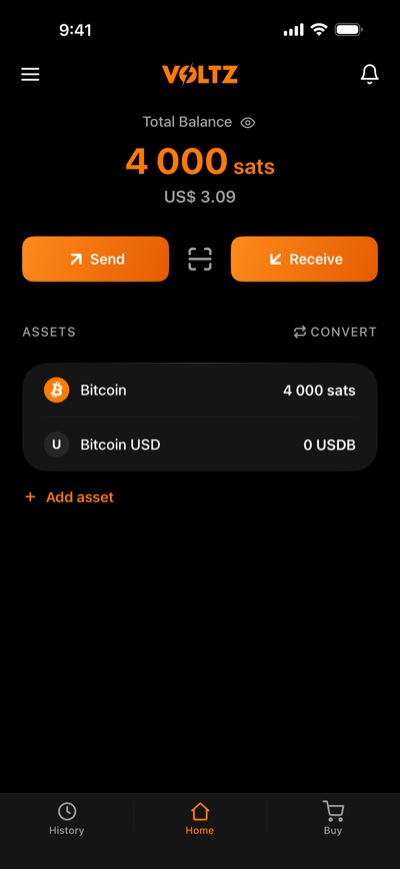
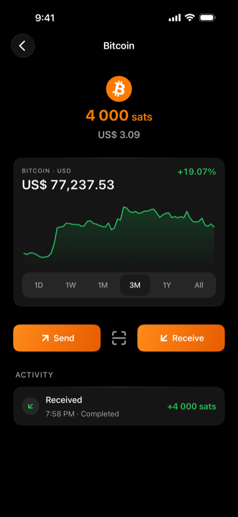
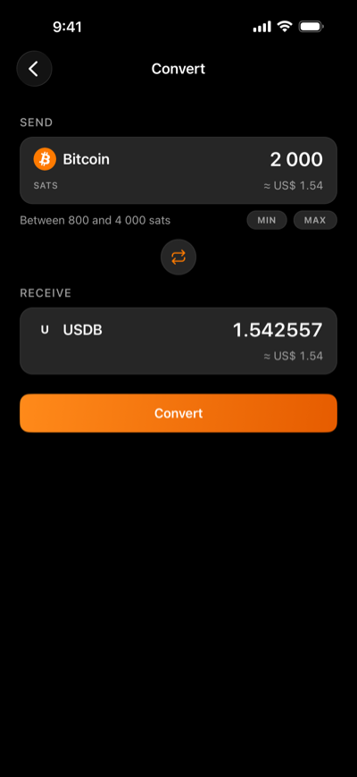

# Voltz Wallet

A self-custody bitcoin wallet for iOS and Android, built on the Breez SDK Spark.

[](https://github.com/voltzbtc/voltz-wallet/actions/workflows/app-check.yml)
[](https://github.com/voltzbtc/voltz-wallet/actions/workflows/app-audit.yml)
[](LICENSE)


<p align="center">
  
  
  
</p>

Voltz Wallet holds bitcoin and Spark tokens, and it sends and receives over Spark, Lightning and
on-chain Bitcoin. The keys are created on the phone and never leave it, and only those keys can
move the funds. The app and its support pages are at [usevoltz.app](https://www.usevoltz.app).

## What it does

- **Sends and receives** over Spark, Lightning (invoices, LNURL and lightning addresses) and
  on-chain Bitcoin from one balance, with a scanner that reads any of them from the camera or from
  an image.
- **Keeps a stable balance in USDB**, the dollar stablecoin on Spark, and converts between bitcoin
  and USDB inside the wallet. USDC and USDT on other networks can be a send destination or a receive
  source, converted on arrival.
- **Holds Spark tokens.** USDB and DePix are listed by default, and any other token is added by its
  identifier, with a warning when its name imitates a known token.
- **Gives every wallet a lightning address**, `name@usevoltz.app`, that receives while the app is
  closed. Other names, and addresses on a domain of your own such as `name@pay.example.com`, are
  in-app purchases through the App Store and Google Play.
- **Creates wallets from a passkey** on devices that support it, deriving the recovery words on the
  device from the passkey, or from a BIP39 recovery phrase with an optional passphrase, its entropy
  optionally drawn from dice rolls. Several wallets can live on one device.
- **Leaves Spark on its own when it has to.** When the Spark operators stop serving the wallet, the
  emergency exit moves its bitcoin onto the Bitcoin chain, with the network fees paid from another
  wallet. Tokens do not leave this way.
- **Buys bitcoin by card** through a third-party provider, delivered straight to the wallet's own
  address.
- **Locks behind a PIN** or biometrics, asks again after two minutes away, covers the app in the app
  switcher, and hides the recovery words while the screen is recorded or mirrored.
- **Speaks 24 languages** and shows values in the currency the person chooses.

## Security model

- **The keys stay on the device.** The recovery phrase is generated on the phone from the platform's
  secure random source, stored in the iOS Keychain or the Android Keystore bound to that device, and
  never sent to any server. Every payment is signed on the phone. A passkey wallet derives its words
  on the device from the passkey. The passkey itself may be synced, end to end encrypted, by the
  person's own Apple or Google account, and the project never receives it.
- **Nothing is held in custody.** No server run by the project holds funds, fiat included. A card
  purchase delivers bitcoin to the wallet's own address.
- **The Spark operators cannot spend alone.** Funds on Spark need the wallet's signature to move,
  and the emergency exit takes them to the Bitcoin chain if the operators stop answering. The Spark
  network's own trust model is documented by [Breez](https://sdk-doc-spark.breez.technology/).
- **The lightning address service is optional and cannot spend.** It answers for names and domains
  and relays payment notices, and it never receives a private key or a recovery phrase. What it can
  and cannot do, compromised or not, is set out in [docs/trust-model.md](docs/trust-model.md).
- **The build is guarded.** Dependency install scripts are off and new versions wait before they
  are installed ([docs/supply-chain.md](docs/supply-chain.md)), CI scans for secrets and audits
  dependencies, and a release build refuses to sign with the debug key
  ([docs/release-signing.md](docs/release-signing.md)).

To report a vulnerability, follow [SECURITY.md](SECURITY.md). Do not open a public issue.

## Architecture

The app is React Native 0.86 on the New Architecture with Hermes, written in TypeScript. The
[Breez SDK Spark](https://sdk-doc-spark.breez.technology/) is its only wallet engine.

```
App.tsx            boot, PIN gate
src/
  wallet/          logic kept out of React and tested directly
    spark.ts       the one module that talks to the Breez SDK (passkey.ts for its passkey provider)
  screens/  components/  navigation/  hooks/
  i18n/            i18next setup and 24 locales
  theme.ts         design tokens for every size and colour
  config.ts        the only reader of the build's .env values
specs/             native module specs (store, capture, privacy cover, durable files, QR images)
ios/  android/     the native projects and the modules behind those specs
__tests__/         the Jest suite
```

- **Screens never talk to the SDK.** `src/wallet/spark.ts` and `src/wallet/passkey.ts` are the only
  importers of the binding, and the rest of the app calls their functions and reads the UI-shaped
  types they return ([docs/breez-sdk-binding.md](docs/breez-sdk-binding.md)).
- **Logic lives in `src/wallet/`**, outside components. Amounts and fiat conversion, history,
  address rules, the emergency exit's plan and the files that must survive a crash are each a module
  with its own tests, negative and edge cases included.
- **Native code stays thin.** Store purchases, screen capture signals, the privacy cover, synced
  file writes and QR codes read from images each go through a small native module with a single
  TypeScript reader.
- **UI follows the design system** in [docs/design-system.md](docs/design-system.md), and every
  string goes through i18next ([docs/i18n.md](docs/i18n.md)).

[AGENTS.md](AGENTS.md) is the full working guide to the code, with its architecture rules, layout
and the traps that break things without breaking the tests.

## Getting started

### Requirements

- Node.js 22.11 or later, with npm
- For iOS, macOS with Xcode, plus Ruby and Bundler for CocoaPods
- For Android, Android Studio with the Android SDK and JDK 17
- A Breez SDK API key, requested from Breez at <https://breez.technology/request-api-key/>

The app runs on iOS 15.1 or later and Android 7.0 (API 24) or later. The React Native environment
guide covers the platform tooling: <https://reactnative.dev/docs/set-up-your-environment>.

### Setup

```bash
git clone https://github.com/voltzbtc/voltz-wallet.git
cd voltz-wallet
npm run setup           # locked dependencies, the SDK's native artifacts, Firebase placeholders
cp .env.example .env    # then set BREEZ_SPARK_API_KEY
```

Use `npm run setup`, never `npm install`. The project's `.npmrc` turns dependency install scripts
off, so the setup script fetches the Breez SDK's native libraries explicitly. Without them the iOS
and Android builds fail even though the tests pass. It also writes placeholder Firebase files, which
keep the build working without push notifications ([docs/firebase.md](docs/firebase.md)).

`.env.example` explains each variable. Only `BREEZ_SPARK_API_KEY` is required. Left empty,
`BREEZ_LNURL_DOMAIN` keeps lightning addresses on the SDK's default LNURL server, with no server of
the project involved.

For iOS, install CocoaPods through Bundler and then the pods, on the first clone and after any
change to native dependencies:

```bash
bundle install
cd ios && bundle exec pod install && cd ..
```

### Run

```bash
npm start               # Metro
npm run ios             # in another terminal, macOS only
npm run android
```

Values from `.env` are compiled into the JavaScript bundle. After editing `.env`, restart Metro with
`npm start -- --reset-cache`, or the app keeps the previous values.

### Check

```bash
npx jest                        # tests
./scripts/typecheck.sh          # types; use this rather than tsc directly
npx eslint .                    # lint
node scripts/check-secrets.mjs  # no seed, key or filled API key in tracked files
node scripts/audit-gate.mjs     # dependency audit
npm run mutate                  # Stryker mutation run over src/wallet, slow
```

CI runs the first three as `app-check`, and the secret scan and the dependency audit as
`app-audit`, on every pull request and on every push to `main`. A separate workflow,
`device-smoke`, builds a debug Android app and checks that it starts on an emulator, on demand.

## Documentation

### Principles, security and engineering

- [docs/principles.md](docs/principles.md), the three rules every change keeps
- [docs/trust-model.md](docs/trust-model.md), what the lightning address service, passkeys, the
  update notice and the exit relay can and cannot do
- [docs/open-risks.md](docs/open-risks.md), the risks to keys and funds that remain open
- [docs/supply-chain.md](docs/supply-chain.md), how dependencies are installed and changed
- [docs/release-signing.md](docs/release-signing.md), how Android release builds are signed
- [docs/testing.md](docs/testing.md), conventions and known traps of the suite

### Wallet

- [docs/breez-sdk-binding.md](docs/breez-sdk-binding.md), what the SDK's React Native binding does
  that its documentation does not make obvious
- [docs/stablecoin-usdb.md](docs/stablecoin-usdb.md), Spark tokens, USDB and the stable balance
- [docs/dollar-mode-onchain.md](docs/dollar-mode-onchain.md), an on-chain send from a wallet held in
  USDB
- [docs/emergency-exit.md](docs/emergency-exit.md), moving funds on-chain without the operators
- [docs/passkey.md](docs/passkey.md), wallets whose words come from a passkey
- [docs/onboarding.md](docs/onboarding.md), the first-run stages and what going back does in each
- [docs/app-lock.md](docs/app-lock.md), the PIN asked again after time away
- [docs/nfc.md](docs/nfc.md), reading a payment destination from an NFC tag on Send

### Lightning addresses and purchases

- [docs/custom-domain.md](docs/custom-domain.md), lightning addresses on a domain of your own
- [docs/store-bridge.md](docs/store-bridge.md), the App Store and Google Play bridge
- [docs/push-notifications.md](docs/push-notifications.md), push notifications while the app is
  closed
- [docs/firebase.md](docs/firebase.md), the Firebase files kept out of git
- [docs/data-deletion.md](docs/data-deletion.md), deleting what the address service keeps for a
  wallet

### Interface

- [docs/design-system.md](docs/design-system.md), the visual tokens and rules
- [docs/design-system-migration.md](docs/design-system-migration.md), what moving onto the design
  system changed and left out
- [docs/i18n.md](docs/i18n.md), strings, plurals, numbers and dates in every locale
- [docs/price-chart.md](docs/price-chart.md), the bitcoin price and the asset screen
- [docs/explorers.md](docs/explorers.md), where a transaction link opens

## Contributing

Contributions are welcome. Read [CONTRIBUTING.md](CONTRIBUTING.md) before opening a pull request. It
lists the checks to run, the rules the tools enforce only in part, and the contributor terms that
every contribution is submitted under. Bug reports and feature requests use the forms under Issues,
and everyone taking part follows the [Code of Conduct](CODE_OF_CONDUCT.md).

## License

The source is published for transparency and review under the
[PolyForm Strict License 1.0.0](LICENSE), which names the copyright holder. The license lets you read the code and use the software
for noncommercial purposes, such as personal use. It does not allow commercial use, distributing the
software, or making changes or new works based on it. The
[contributor terms](CONTRIBUTING.md#contributor-terms) add only the permission needed to prepare
and submit a contribution to this repository.

Bundled third-party files keep their own licences, listed in
[THIRD_PARTY_NOTICES.md](THIRD_PARTY_NOTICES.md).
